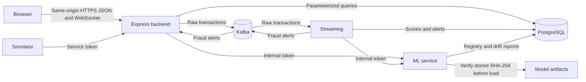

# FraudLens threat model

Scope covers the browser, Express API and WebSocket server, PostgreSQL, Kafka, the Spark streaming job and the internal FastAPI service. Assets include session and service credentials, raw account references, alerts and investigator actions, model artifacts and metadata, audit evidence, and service availability.

The browser and simulator cross the public API boundary. Kafka, PostgreSQL and ML remain internal in the base Compose configuration and have separate Kubernetes services. The Kubernetes ingress policies cover PostgreSQL and ML. Enforcement depends on the cluster network plugin. Kafka raw topics and the DLQ are inside the trusted data pipeline and can contain sensitive input.

| STRIDE | Entry and potential impact | Current controls and code | Residual risk |
|---|---|---|---|
| Spoofing | Session cookies, login, service headers. False user or service identity | Expiring HS256 JWT, bcrypt, generic login errors, throttling, service token comparison and current DB account checks in `backend/src/utils/jwt.js` and `backend/src/middleware/`. ML accepts only a configured token in `ml-service/app/security.py`. FR-01, FR-02 | Credential theft, shared token rotation, and replay of a copied session until expiry or revocation |
| Tampering | User changes, database records and model artifacts. Fraud decisions or privileges can be altered | Role checks and validated shapes at route boundaries. Audit chain, transaction lock and verifier in `backend/src/audit/` and `backend/scripts/`. Registry digest is checked before model loading. FR-02, FR-12, FR-13 | A writer controlling the whole chain and its evidence can rewrite or truncate it. A trusted external checkpoint would improve detection. The registry and artifact store both need access controls. |
| Repudiation | Account operations and alert decisions. Operator disputes an action | Request IDs and attributed audit events with a deterministic hash. Audit verification provides a first failing row. FR-12 | Audit failures are logged and can leave gaps. IP attribution behind proxies and historical JSON key order need operational review. |
| Information disclosure | API responses, WebSocket alerts, database and Kafka topics. Exposure of account references or secrets | Response masking, httpOnly cookies, admin-only audit and user projections, and defensive audit-field filtering. Kubernetes gives each app only selected secret keys. FR-02, FR-12, FR-13 and contract masking §2 | Kafka, DLQ and database access still use shared infrastructure. Raw identifiers exist inside the pipeline. Treat logs and backups as sensitive. |
| Denial of service | Login, API and ingestion. Password hashing, DB or Kafka resources can be exhausted | Login rate and per-account lockout, API quotas, 100 KiB JSON limit, service-only quota exemption in `backend/src/middleware/apiHardening.js`. FR-01, ingestion contract §8 | Per-process rate counters share a proxy quota without trusted proxy configuration. Capacity for trusted service traffic and WebSockets requires load testing. |
| Elevation of privilege | Admin routes, stale role and mass assignment. Unauthorized user or model changes | DB-backed role checks, explicit schemas and SQL assignments, self-demotion/disable protection, WebSocket account rechecks. FR-02, FR-13 | Database-role separation, production browser/proxy verification and full cross-service integration still need deployment evidence. |

The contract defines WebSocket alerts for any logged-in role. The REST alert list and mutation routes require ADMIN or ANALYST. Treat any change to this split as a product decision.
